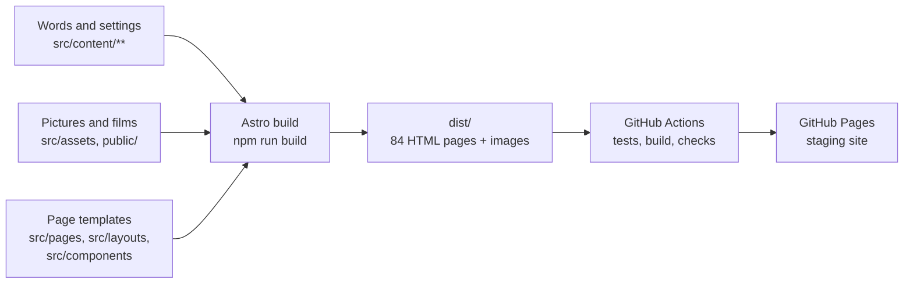
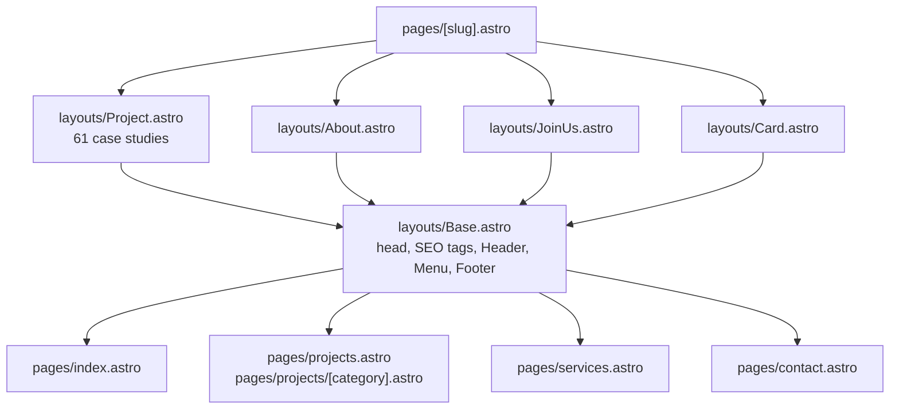

# Achates 360 website — blueprint

Where everything lives, how a page is put together, and where to look when something breaks.
For how the site is organised for visitors (sitemap, navigation, categories, journeys), see
[INFORMATION-ARCHITECTURE.md](INFORMATION-ARCHITECTURE.md); for the design rules, [../DESIGN.md](../DESIGN.md).
Last checked against the code: 19 Oct 2026. Design decisions and their reasons are in
[DIRECTION-B.md](DIRECTION-B.md); open questions for the client are in [../CONTENT-QUERIES.md](../CONTENT-QUERIES.md).

---

## 1. The site in one picture

The site is **static**: every page is built ahead of time into plain HTML files. There is no server,
database or CMS. The words and pictures live in files in this repository; changing a file and publishing
rebuilds the site.



| | |
|---|---|
| Framework | [Astro](https://astro.build) 7, plain CSS, GSAP for scroll animation |
| Node | version in `.nvmrc` (24) |
| Repository | `mingkey88/achates360-website` (public: never commit passwords, font files, the letterhead or client documents) |
| Working branch | `direction/croma`; `main` is what is live |
| Staging | https://mingkey88.github.io/achates360-website/ (hidden from search engines) |
| Production | not yet live; will be https://www.achates360.com (see §9) |

---

## 2. Folder map

```
achates360-website/
├─ src/
│  ├─ content/          ← ALL WORDS (and which picture goes where). Start here for copy changes.
│  ├─ content.config.ts ← the rules each content file must follow (a broken file stops the build)
│  ├─ pages/            ← one file per page or URL pattern
│  ├─ layouts/          ← page templates (Base wraps every page; Project = case studies; About; …)
│  ├─ components/       ← page sections (hero, showreel, footer, …); ui/ = small parts
│  ├─ lib/              ← logic: lists, counts, SEO, accents, layouts of case studies, …
│  ├─ scripts/motion/   ← scroll animations (GSAP), one file per effect
│  ├─ styles/           ← tokens.css (colours, type sizes, spacing), base.css, type.css
│  └─ assets/           ← pictures processed at build (resized, AVIF/WebP)
├─ public/              ← files served as-is: films (media/video), client logos (clients/)
├─ scripts/             ← checks (verify, overflow, films) and the old Wix importer
├─ docs/                ← this blueprint, design decisions, reports
├─ CONTENT-QUERIES.md   ← questions for the client, numbered
└─ .github/workflows/   ← the build-and-publish pipeline
```

---

## 3. Pages and where their words come from

| URL | Page file | Template | Main sections | Words and pictures from |
|---|---|---|---|---|
| `/` | `src/pages/index.astro` | Base | VideoHero (the showreel, full-screen) → WorkStack → studio sentence → ServiceIndex → Credentials → ScatterCTA | `content/home/home.md`, `content/extras/*`, About text (studio sentence) |
| `/projects` | `src/pages/projects.astro` | Base | heading, CategoryTabs, ProjectCards | homepage gallery list in `home.md` (`allProjects`), `content/projects/*` |
| `/projects/<category>` | `src/pages/projects/[category].astro` | Base | heading, CategoryTabs, ProjectCards | `content/projectsIndex/projects.md` (categories) |
| `/<project>` (61 case studies) | `src/pages/[slug].astro` | Project | hero, MetaStrip, ArtRows, CaseNotes, NextProject | `content/projects/<slug>.md`, layout in `content/art/<slug>.yaml`, notes in `content/notes/<slug>.yaml` |
| `/about` | `[slug].astro` | About | statement, since, Chronology, companion, visual, office, awards chapter, Credentials, colophon, CloseCTA | `content/basic/about.md`, `extras/timeline.yaml`, `extras/stats.yaml`, `extras/clients.yaml` |
| `/services` | `src/pages/services.astro` | Base | ServicesContents, Showreel, ServiceSpread ×4, ProcessSteps, CloseCTA | `extras/services.yaml`, `extras/process.yaml` |
| `/contact` | `src/pages/contact.astro` | Base | ContactForm | `home.md` (`contact` block: intro, form fields), footer address in `site.md` |
| `/joinus` | `[slug].astro` | JoinUs | job listings | `content/basic/joinus.md` |
| `/<name>` (team cards) | `[slug].astro` | Card | business card | `content/cards/<name>.md` |
| `/404` | `src/pages/404.astro` | Base | paper-cut "404", links | strings, also redirects old Wix addresses |
| `/llms.txt`, `/robots.txt`, `/sitemap.xml` | `src/pages/*.ts`, `astro.config.mjs` | — | for search and AI engines | generated from the content |

Every page also gets the **header, menu and footer** from `src/layouts/Base.astro` (menu labels and
footer text: `content/site/site.md`).



---

## 4. Where is the copy? (the index)

**Rule of the project:** the client's words are never changed in the files. Anything new we wrote is
marked `placeholder: true` (Draft) until the client approves it, and logged in CONTENT-QUERIES.

### Site-wide
| What | File | Field |
|---|---|---|
| Menu labels, menu order | `content/site/site.md` | `menu:` |
| Footer intro line, address, email, phone, social links, © line | `content/site/site.md` | `footer:` |
| Small labels and new headings ("Write to us.", "How we work", "Back to top", tab names, …) | `content/extras/strings.yaml` | one line per `id` |
| Which word of a heading is orange | `src/lib/accents.ts` | `ACCENTS`, `ABOUT_ACCENTS`, `FOOTER_ACCENT` |
| Page titles and descriptions for Google | each content file | `seo:` (`title`, `description`) |

### Homepage
| What | File | Field / note |
|---|---|---|
| Hero tagline "faithful friend • thoughtful design" | `strings.yaml` | `hero-tagline` |
| Hero ring of ten projects | `home.md` `allProjects` | first ten listed projects, in that order |
| Homepage showreel | `public/media/video/achates360-showreel*.mp4`, poster `src/assets/showreel-poster.jpg` | label and buttons: strings `showreel-*`, `selected-cta` |
| Studio sentence ("The name Achates 360 reflects…") | `content/basic/about.md` | taken from the About text |
| Trusted by: client logos | `content/extras/clients.yaml` + `public/clients/*.svg|png` | one line per client: `name`, `logo`, `ratio` |
| Awards list | `strings.yaml` | `awards-line` (awards separated by " · ") |
| Figures (2001, 53, 12, 100+) | `content/extras/stats.yaml` | "53" is counted automatically from listed projects |
| Services list | `content/extras/services.yaml` | `title`, `tags` (which project categories it covers) |
| Closing scatter of printed work | `src/pages/index.astro` | `SCATTER` list of project slugs |

### Projects and case studies
| What | File | Field |
|---|---|---|
| Project title, client, year, categories | `content/projects/<slug>.md` | `title`, `client`, `copyright`, `categories` |
| Shown in lists or hidden | same | `listed: true/false` |
| Case-study text and pictures (in order) | same | `blocks:` (text, image, embed, link) |
| How the pictures are arranged | `content/art/<slug>.yaml` (45 hand layouts) | if missing, the standard template (`lib/art.ts`) |
| Case notes (from the portfolio deck) | `content/notes/<slug>.yaml` | 3 projects |
| Card title/thumbnail on /projects | `home.md` `allProjects` | title, client line, thumbnail |
| Category names and which projects are in them | `content/projectsIndex/projects.md` | `sections:` |
| A film's private Vimeo key | project file, embed block | `hash:` |

### About, Services, Contact
| What | File |
|---|---|
| About text (statement, since, name, "thinking made visual") | `content/basic/about.md` |
| Story milestones (year comes from the project) | `content/extras/timeline.yaml` |
| Office photo captions | `strings.yaml` (`office-*`) |
| Colophon lines | `strings.yaml` (`colophon-*`) |
| Service names and descriptions | `content/extras/services.yaml` |
| "How we work" steps | `content/extras/process.yaml` |
| Contact intro and form fields | `content/home/home.md` → `contact:` |
| Contact "Finding us" photos | `src/pages/contact.astro` + `src/assets/office/` |
| Testimonials (hidden until real ones arrive) | `content/extras/testimonials.yaml` |

### Draft copy
- A line with `placeholder: true` is still waiting for the client. The site no longer shows a "Draft"
  mark, but the flag stays so nobody forgets.
- A sentence starting with `[Draft]` is an instruction, not copy, and is hidden from visitors
  (`lib/copy.ts` → `isStub`). Replace the whole sentence and set `placeholder: false`.
- The **production** build refuses to run while any placeholder remains (`lib/placeholders.ts`).

---

## 5. Pictures, films and logos

| What | Where | Notes |
|---|---|---|
| Case-study pictures | `src/assets/wix/…`, `src/assets/<project>/` | referenced from the project file's `blocks`; resized automatically |
| Office photos | `src/assets/office/` | |
| Brand and share images | `src/assets/og-default.jpg` (drawn by `node scripts/make-og.mjs`), `logo-*.svg` | Case studies share their own hero picture |
| Films (showreel) | `public/media/video/` | served as-is; keep each file under 25 MB |
| Embedded films | YouTube/Vimeo IDs in project files | `npm run check:films` tests they still play |
| Client logos | `public/clients/` | white artwork, trimmed; recoloured on the page |

**Size budget:** the built site must stay under 800 MB (`npm run verify`); today about 690 MB.
Pictures are served at up to 2560px wide, in AVIF and WebP; a larger original is fine.

---

## 6. Look and feel

| What | File |
|---|---|
| Colours (ink, paper, brand orange `--accent` #ff9015, text orange `--accent-text` #e06c00, tints) | `src/styles/tokens.css` |
| Type sizes, fonts, spacing, the page grid | `src/styles/tokens.css`, `type.css` |
| Global rules (orange words `.hl`, crop marks `.crop`, wrap width) | `src/styles/base.css` |
| A section's own look | inside its component, in the `<style>` block |

### Scroll animations
Each page loads only the effects it needs (`src/scripts/motion/manifest.ts`; a test checks this
matches each page's script). Visitors who ask for reduced motion get every section finished and still.

| Effect | File | Where |
|---|---|---|
| Counting figures | `counters.ts` | homepage, About |
| Draggable printed pieces + Reset | `scatter.ts`, `src/scripts/pile.ts` | homepage end |
| Chronology held stage, figures joining, sentence inking in | `story.ts` | About |
| How we work press run | `press.ts` | Services |
| Fade/rise in, card tilt | `reveal.ts`, `tilt.ts` | most pages |

---

## 7. Common changes, step by step

**Change a sentence or label**
1. Find it in §4, edit the file, keep the wording exactly as the client gave it.
2. If it was Draft and is now approved, set `placeholder: false`.
3. If it is a heading with an orange word and the wording changed, update `lib/accents.ts` (the tests
   will fail and name it if you forget).

**Add a new case study**
1. Create `content/projects/<slug>.md` (copy a similar project as a starting point). The slug becomes
   the URL; never change an existing slug (old links and Google depend on it).
2. Put its pictures in `src/assets/<slug>/` and reference them in `blocks`.
3. Add it to `home.md` → `allProjects` (its card on /projects; its order gives its № number) and to the
   right category in `projectsIndex/projects.md`.
4. Optional: a hand layout in `content/art/<slug>.yaml`.

**Hide a project:** set `listed: false`. It disappears from lists, cards and counts.

**Add or swap a client logo:** put the white artwork in `public/clients/`, add a line to
`extras/clients.yaml` (`ratio` = width ÷ height of the artwork). A test fails if the file is missing.

**Change the phone, address or email:** `content/site/site.md` → `footer` (the contact page and the
search-engine data read it from there).

**Change a colour:** `src/styles/tokens.css`. Keep orange words on `--accent-text` (readable); bars and
fills on `--accent`.

**Connect the contact form:** set `PUBLIC_FORM_ENDPOINT` (a form service's address) as a build
setting; `components/ContactForm.astro` posts to it. Until then it says "Form not connected on staging".

**Change the default share picture** (what WhatsApp, LinkedIn and Facebook show for pages without
their own picture): `node scripts/make-og.mjs <picture>` redraws `src/assets/og-default.jpg` with
"360" cut over that picture. Networks keep an old preview for a while; LinkedIn's Post Inspector and
Facebook's Sharing Debugger refresh it.

**Share links on case studies:** `components/ui/ShareLinks.astro` (LinkedIn, Facebook, WhatsApp,
Copy link), shown as the last column of the project's details. Labels: strings `share-*`.

**Turn on Cloudflare Web Analytics:** in Cloudflare, Web Analytics → Add a site → enter the site's
address, and copy the token from the snippet it shows. In GitHub: Settings → Secrets and variables →
Actions → Variables → New repository variable `CF_ANALYTICS_TOKEN` with that token, then publish. The
next build adds Cloudflare's beacon to every page (`layouts/Base.astro`); no variable, no beacon.
Cookieless, so no consent banner. Once the site is hosted on Cloudflare Pages with analytics switched
on in the Pages project, delete the variable: Cloudflare then adds the beacon itself, and both would
count every visit twice.

---

## 8. Checks (run before publishing)

| Command | What it catches |
|---|---|
| `npm test` | 419 tests: content rules, accents still matching, every client logo present, counts, SEO data, motion manifest |
| `npm run build` | type errors, broken content files, missing pictures, a project referenced but missing |
| `npm run verify` | site over the size budget, scripts too heavy, broken internal links, a page that must exist missing (incl. the business-card pages on printed QR codes) |
| `npm run check:overflow` | any page scrolling sideways on phones; content hidden on first screen |
| `npm run check:films` | YouTube/Vimeo films that no longer play |
| `npm run preview` | the built site locally (http://localhost:4321/achates360-website/ by default) |

The build stops with a message naming the file and problem; read the first error, it is usually the cause.

---

## 9. Publishing

**Staging (today):** commit on `direction/croma` → open a pull request into `main` → merge. GitHub
Actions (`.github/workflows/`) runs the tests, builds, checks and publishes to GitHub Pages in about
four minutes. A failed check stops the publish; the live site stays as it was.

**Production (planned):** build with `SITE_ENV=production`. That switches the address to
https://www.achates360.com, opens the site to search engines, writes the real sitemap and refuses to
build while Draft copy remains. Hosting choice and the DNS switch (domain managed through Vodien /
WebHostSG; email on Microsoft 365, whose DNS records must be kept) are in the conversation notes and to
be written up before launch.

---

## 10. When something looks wrong

| Symptom | Look at |
|---|---|
| A word or sentence is wrong | §4 to find the file; check `placeholder` |
| A whole sentence missing on Services or About | it starts with `[Draft]` (hidden on purpose) |
| An orange word is missing or the wrong one | `src/lib/accents.ts` |
| A project missing from /projects or a category | `listed`, `home.md` `allProjects`, `projectsIndex/projects.md` |
| A case study's pictures look badly arranged | `content/art/<slug>.yaml` (or remove it to use the standard template) |
| A film shows a grey box / does not play | `npm run check:films`; Vimeo needs `hash:`; dead films listed in `lib/unavailable-films.ts` |
| A picture is blurry | the original is small; replace the file in `src/assets` |
| Counts look wrong (53, category numbers) | `listed` flags; categories in `projectsIndex/projects.md` |
| An animation stuck or jumps | the effect's file in `src/scripts/motion/`; test with reduced motion to see the still version |
| Background grid scrolls during a held section | the held section's own grid (`--grid-y` in `story.ts`, `press.ts`) |
| Page scrolls sideways on a phone | `npm run check:overflow` names the page and element |
| Old Wix link lands on 404 | `src/pages/404.astro` (`moved` list) |
| Build fails after a content edit | the error names the file and field; compare with `content.config.ts` |
| Publish failed | GitHub → Actions tab → the red run → the failed step |

---

## 11. Do not

- Run `npm run export`: it is the one-off Wix importer and would overwrite edited content.
- Rename a project's slug or file (URLs, Google and card links depend on it).
- Commit passwords (the Wix password is only ever an environment variable, `WIX_PAGE_PASSWORD`), paid
  font files, the letterhead or client documents: the repository is public.
- Add a film over 25 MB to `public/`; host it on Vimeo and embed it.
- Change the client's wording without logging it in CONTENT-QUERIES.

## 12. Parts kept but not in use

`components/FeaturedStack`, `LetsConnect`, `ServicesPreview`, `StatsBand`, `Testimonials` (earlier
homepage designs). Safe to delete once the design is signed off.
