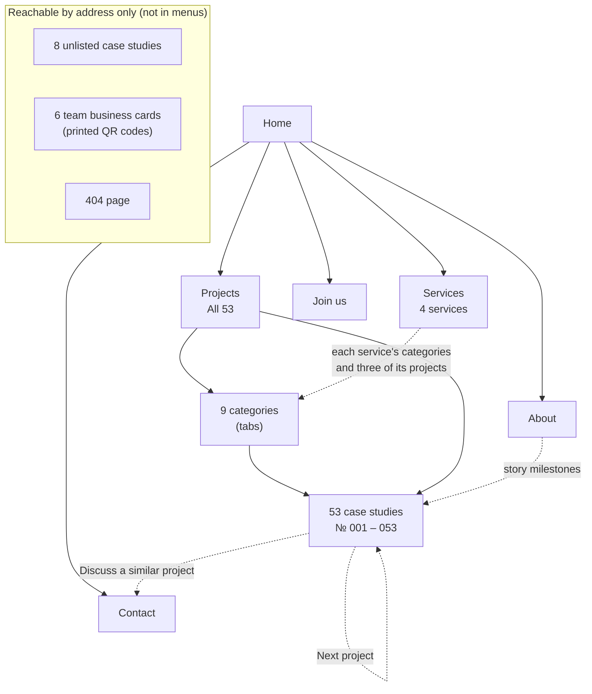
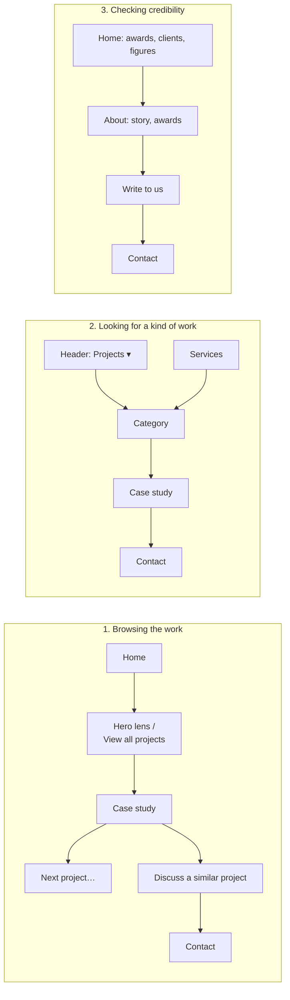

# Achates 360 website — information architecture

How the site is organised **for the people who use it**: what pages exist, how they are grouped and
named, how visitors move between them, and where they end up getting in touch.
For how the site is built and where each piece of copy is stored, see [BLUEPRINT.md](BLUEPRINT.md).
Last checked against the built site: 20 Oct 2026 (84 pages).

---

## 1. Who the site is for, and what it should do

| Visitor | Wants to | Main path |
|---|---|---|
| **Prospective client** (marketing or corporate communications at a bank, hotel, MNC or public body) | See relevant work, judge quality and credibility, get in touch | Home → work → case study → Contact |
| **Client already shortlisting** | Check experience in their kind of work, awards, who else trusts the studio | Projects → category → case studies; About |
| **Job seeker** | See the studio and its open roles | Home or About → Join us |
| **Someone given a business card** | Save a contact | QR code → team card → save contact |
| **Search and AI engines** | Understand who the studio is and what it has made | sitemap.xml, llms.txt, structured data |

**Primary goal:** an enquiry (contact form or email). **Supporting goals:** credibility (awards,
clients, years), recruitment.

---

## 2. Sitemap

### All pages (84)

| Level | Page | Address | Count |
|---|---|---|---|
| 0 | Home | `/` | 1 |
| 1 | Projects (all work) | `/projects` | 1 |
| 2 | Project categories | `/projects/<category>` | 9 |
| 2/3 | Case studies (listed) | `/<project>` | 53 |
| 1 | Services | `/services` | 1 |
| 1 | About | `/about` | 1 |
| 1 | Join us | `/joinus` | 1 |
| 1 | Contact | `/contact` | 1 |
| — | Case studies not listed anywhere (kept so old links still work) | `/<project>` | 8 |
| — | Team business cards (from printed QR codes) | `/abby`, `/angeline`, `/belinda`, `/chuan`, `/donna`, `/joseph-chan` | 6 |
| — | Old Wix duplicate of Projects (points search engines to `/projects`) | `/copy-of-projects` | 1 |
| — | Page not found | `/404` | 1 |
| | **Total** | | **84** |

Machine-readable files: `/sitemap.xml` (search engines), `/robots.txt`, `/llms.txt` (AI answer engines).

**Unlisted case studies (8):** bank-of-singapore, dbs-discretionary-portfolio-management,
ritz-carlton-mid-autumn, singapore-aviation-academy, redpacket, uel-annual-report, and two Wix
duplicates (copy-of-grohe-quarterly-campaigns, international-green-building-conference) that point to
their originals. Two of them (bank-of-singapore, ritz-carlton-mid-autumn) are also hidden from search
while their content is fixed (CONTENT-QUERIES 46).

---

## 3. Navigation

### Global (on every page)
| Where | What it holds |
|---|---|
| **Header** (desktop) | Logo (→ Home) · Projects ▾ ("Projects" opens all the work; its dropdown lists the 9 categories) · Services · About · Join us · **Contact** (framed button) |
| **Menu** (phones and tablets) | Home · Projects (+ the 9 categories) · Services · Contact · About · Join us · Facebook, Instagram, LinkedIn, Vimeo |
| **Footer** | Intro line · Projects, Services, Contact, About, Join us · email, phone, address · Instagram, Facebook, Vimeo, LinkedIn · Back to top |

The current section is marked in the header and menu with an orange bar.

### Local (within a section)
| Page | Ways onward |
|---|---|
| Home | Hero ring of 10 projects · Showreel · "View all projects" · client logos · services list (→ each service on /services) · closing "Get in touch" |
| Projects / category | **Category tabs** (All + 9, with counts, current one marked) · 53 cards |
| Case study | Its categories (→ category pages) · ← Back to projects · **Next project** (in catalogue order) · **Discuss a similar project** (→ Contact) |
| Services | Contents (→ each service) · each service's categories (→ category pages) · "More in this service" (3 projects) · Write to us (→ Contact) |
| About | Story milestones (8, → case studies) · Write to us (→ Contact) |
| Team card | Save contact (.vcf) |

### Ways to get in touch (conversion points)
Header **Contact** button (every page) · **Write to us** at the end of Services, About and case
studies · **Discuss a similar project** on every case study · homepage closing **Get in touch** ·
footer email address · contact form on `/contact`.

---

## 4. How the work is organised (taxonomy)

### Catalogue
Every listed project has a catalogue number, **№ 001 – 053**, in the order of the homepage's project
gallery. The number appears on its card wherever it is shown, so a project keeps one identity across
the site. "Next project" follows this order.

### Categories (9) — a project can be in several
| Category | Projects |
|---|---|
| Strategic Branding | 10 |
| Advertising & Promotions | 15 |
| Graphic Design | 17 |
| Content Creation | 11 |
| Social Media | 12 |
| Publications | 14 |
| Digital Communications | 9 |
| Packaging & Merchandise | 11 |
| Events | 12 |

(The counts add up to more than 53 because most projects sit in two or three categories.)

### Services (4) — each groups categories
| Service | Covers the categories | Projects |
|---|---|---|
| Branding & Identity | Strategic Branding, Graphic Design, Packaging & Merchandise | 27 |
| Publications & Reports | Publications, Content Creation | 23 |
| Campaigns & Promotions | Advertising & Promotions, Events | 24 |
| Digital & Social | Digital Communications, Social Media | 19 |

Services are how a client **asks** ("we need an annual report"); categories are how the work is
**filed**. The Services page bridges the two by linking each service to its categories and projects.

### What each project carries
Title · client · year · categories · awards (where it has them) · catalogue № · its story (text,
pictures, films) · case notes for three projects.

---

## 5. Page types

| Type | Pages | Built from |
|---|---|---|
| Home | 1 | hero, showreel, imprint (clients, awards, figures), studio sentence, services, closing call |
| Index | Projects + 9 categories | heading, category tabs, cards |
| Case study | 61 | hero, details (client · year · categories), story, case notes, Next project |
| Service book | Services | contents, showreel, one spread per service, How we work, close |
| Story | About | statement, since 2001, chronology, the name, thinking made visual, studio, recognition, imprint, colophon, close |
| Form | Contact | intro, form, direct details, finding us |
| Listing | Join us | open roles |
| Card | 6 team cards | name, role, contact, save |
| Error | 404 | "404", links back into the site |

---

## 6. Labels

Menu labels are the Wix site's own (stored in capitals, shown in sentence case): **Projects, Services,
About, Join us, Contact**. Category and project names are the client's, unchanged. Labels added during
the redesign (for example "Write to us.", "How we work", "More in this service", "Back to top",
"Discuss a similar project", "All projects") are new wording awaiting the client's approval
(CONTENT-QUERIES).

---

## 7. Key journeys

Other journeys: **job seeker** (any page → Join us → apply by email to hello@achates360.com); **business card** (QR → card →
save contact → Home).

---

## 8. Known IA issues and suggestions

| Issue | Suggestion | Owner |
|---|---|---|
| Two different LinkedIn addresses (footer: `/company/achates360`; menu: `/company/74970207`) | Use one | Client to confirm |
| Three different phone numbers across website, deck and office PDF | One number everywhere (also matters for Google) | Client (CQ 17) |
| Some project addresses are Wix leftovers (`/mannhummel`, `/notter`, `copy-of-…`) | Cleaner addresses with redirects, before launch | Decision pending |
| 8 unlisted case studies reachable only by old links | Fix and list them, or retire them with redirects | Client |
| Services and categories use different names for related things | Keep both (asking vs filing), linked on Services | — |
| No site search | Not needed at 53 projects; categories and tabs cover it | — |
| Join us has no link from case studies | Fine: job seekers come from Home, About or the footer | — |
